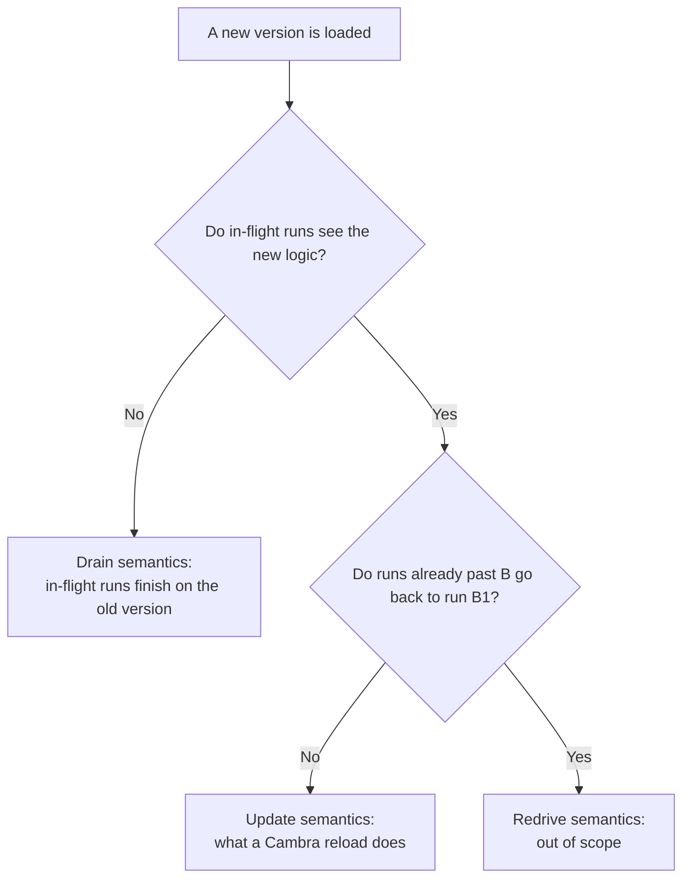

# Workflow Library

An aspirational Cambra library of the primitives for workflow-shaped programs: long-running runs,
calls to remote systems that happen once per key, timers, and changes to the program while runs
are in flight. The library is in the std root, [std/](../../std/README.md), and the programs written
against it are in [tests/programs/workflows/](../../tests/programs/workflows/README.md). None of it
compiles; `[proposed]` marks each construct Cambra main lacks where the code uses it.

Unmarked text describes what that code implements. The rest carries a status marker, as
[chl-spec.md](../chl-spec.md#how-to-read-this-document-status-markers) does:

- **[Decided]** — decided and recorded here, with no code yet.
- **[Proposed]** — a mechanism the code relies on through a `[proposed]` construct, suggested and
  not yet agreed.
- **[Open]** — a question with no answer yet.

The library provides durable execution:

- **Crash recovery.** A crash resumes each run at the step it was waiting on
  ([Interruptions: Crashes and Reloads](#interruptions-crashes-and-reloads)).
- **Reloads.** A reload continues each run in flight on the new version's code
  ([Program evolution](#program-evolution)).
- **Timers.** A wait pending at a crash or a reload resumes ([Time](#time)).
- **Idempotency.** An effect sends each call key once, and its retries reach the remote under an
  idempotency key where the remote takes one ([Keys](#keys), [Retry](#retry)). No layer
  guarantees that a remote acts exactly once.

Each workflow concept is one construct of the library:

| Concept | Construct | Section |
| -- | -- | -- |
| A unit of long-running work | a run of a `std::wf::workflow` | [Runs](#runs) |
| Work repeated on a period | a run per slot of a `std::wf::schedule` | [Schedules](#schedules) |
| A call to a remote system | `send_request` on a `std::wf::effect` | [Calling an effect](#calling-an-effect) |
| A retry policy | a `retry::RetryConfig`; `retry::default_retry()` waits 60 s, then 240 s, and fails at the third failed attempt | [Retry](#retry) |
| A call that failed | an `` `err `` the body handles, and an element on the effect's `failed` while the run is live | [Outputs](#outputs) |
| Reaching runs in flight after a change | a reload | [Program evolution](#program-evolution) |
| Reprocessing held failures | a loop over an effect's `failed` | [Retry loops and cycles](#retry-loops-and-cycles) |
| A wait for a time | `time::wait_until`, or a `std::time::timer` registration | [Time](#time) |

## Example: the bill reminder

One run of `bills` is one bill. One run of the child workflow `reminders` is one bill's reminder
for one day. The effects belong to `reminders`, so each day's reminder looks up a contact, composes
a message and sends it once, and the body completes the day's run once the message is sent.
[bill-reminder.cambra](../../tests/programs/workflows/bill-reminder.cambra) is the full program.

```
type BillWorkflowState = {bill_id: BillId}
impl wf::WorkflowState(BillWorkflowState):
    def get_run_id(self) => String:
        "bill-" + self.bill_id

run std::wf::workflow(State=BillWorkflowState, timeout=`after(time::days(365)),
                     stale_after=`after(time::days(30)))
    as bills
# One child run per bill per day. A bill's end cancels its reminders, and a day still running when
# the next comes due is cancelled.
run std::wf::schedule(parent=bills, every=time::days(1), on_due=`replace) as reminders

run std::wf::effect(workflow=reminders, client=…, config=…) as lookup_contact_info
run std::wf::effect(workflow=reminders, client=lib::openai_chat(…), config=…) as compose_email
run std::wf::effect(workflow=reminders, client=lib::openai_chat(…), config=…) as compose_sms
run std::wf::effect(workflow=reminders, client=lib::resend(…, key_prefix=…), config=…) as send_email
run std::wf::effect(workflow=reminders, client=lib::twilio(…), config=…) as send_sms

# A resent request is one request: the key is the client's idempotency key.
for r in wf::keyed(track_reqs, by=(r) => r.headers["Idempotency-Key"]):
    with begin():
        bills::start(BillWorkflowState(bill_id=r.bill_id))

def send_for_reminder(rem) causes wf::WorkflowCancellationException(_):
    result = match lookup_contact_info::send_request(bill_id=rem.state.parent.bill_id, …):
        case `err(f):
            `err(f)
        case `ok(contact):
            if contact.prefer_sms:
                match compose_sms::send_request(lib::prompt="bill-reminder-sms", …):
                    case `err(f):
                        `err(f)
                    case `ok(body):
                        send_sms::send_request(lib::body=body.lib::text, …)
            else:
                match compose_email::send_request(lib::prompt="bill-reminder-email", …):
                    case `err(f):
                        `err(f)
                    case `ok(body):
                        send_email::send_request(lib::text=body.lib::text, …)
    match result:
        case `ok(_):
            with begin():
                reminders::complete(rem.id)
        case `err(f):
            pass    # the run stays live until a later slot replaces it or a limit ends it

reminders::for_each(send_for_reminder)
```

## Runs

`run std::wf::workflow(State, timeout, stale_after)` declares one workflow's run table. A run is one
unit of long-running work, such as one bill.

### Run ids

`State` is the program's workflow state type. It implements `wf::WorkflowState`
([proposed] declared traits) with one method, `get_run_id(self) => String`. The same state always
names the same run, and `get_run_id` is the only source of run ids. A bill's run id is
`"bill-" + bill_id`, so tracking a bill twice names one run. A run id is the counterpart of
Temporal's Workflow ID, not of Temporal's Run ID, which the server assigns at random to each
execution.

`RunId` is a nominal type
([6.8 Nominal types and methods [Decided]](../chl-spec.md#68-nominal-types-and-methods-decided))
that each `std::wf::workflow` run declares for itself, so `bills::RunId` and `reminders::RunId` are
distinct types even when two workflows share a state type. An effect accepts keys only from its own
workflow, and a `String` never type-checks as a run id. A module given a workflow as a parameter
reaches its id type as a type member, `workflow::RunId`, known only by its kind
([9.8 Module types](../chl-spec.md#98-module-types)), because a nominal type meets no structural
bound. `id_string(id)` is the one way to read an id as text. Only the workflow constructs one.

A route that acts on a run builds the run's state from its request:
`bills::cancel(bills::id(BillWorkflowState(bill_id=r.bill_id)), …)`.

### Starting and reading runs

The run table is one `Txn` map, `runs: Map(RunId, Run)`. A `Run` holds everything the library keeps
about a run: its state, its parent run, its status, its start and last activity times, and its
pending wake. A run's row stays after the run ends. That keeps an ended run from restarting, and it
is what an effect reads to refuse the run's later requests. **[Open]** — how long ended rows are
kept.

```
bills::start(BillWorkflowState(bill_id="42"))    # `started{id}, with id = bill-42
bills::start(BillWorkflowState(bill_id="42"))    # `existing{id, status}: the same run
```

Every function runs in the caller's transaction. `id(state)` does not check that the run exists,
so the functions that read a run answer `` `none `` for a run the workflow does not hold:

| Function | Effect |
| -- | -- |
| `start(state, parent_run=…)` | Starts the run `id(state, parent_run)` and answers `` `started{id} ``; answers `` `existing{id, status} `` if the run exists, ended or not (Temporal's `UseExisting`), or `` `parent_not_live{id} ``. `parent_run` is `` `none `` for a top-level run |
| `id(state, parent_run=…)` | The run id, without starting the run: `get_run_id()`, under the parent run's id for a child |
| `id_string(id)` | The run id as text |
| `get(id)` | `Option(State)`: the run's state, or `` `none `` |
| `status(id)` | `Option(RunState)`: the run's lifecycle state, or `` `none `` |
| `live(id)` | Whether the run is `` `running ``, and, for a dependent child, whether its parent run is live |
| `live_children(parent_run)` | The live runs of this workflow under one parent run, oldest first |
| `complete(id)` | Ends the run `` `completed `` |
| `cancel(id, reason)` | Ends the run `` `cancelled ``, recording the reason |
| `touch(id)` | Records activity, which postpones `stale_after` |

### The cancel route

A workflow serves a route that cancels one run when its `control` parameter names an address:

```
run std::wf::workflow(State=BillWorkflowState, timeout=…, stale_after=…,
                      control=`serve(port="8080", path="/bills/cancel"))
    as bills
```

A `POST /bills/cancel` with the body `{run: "bill-42", reason: "disputed"}` calls
`cancel(id, reason)` on the run whose id is `bill-42`, and replies with the run's status.

- The request names the run by its id as text, so an operator needs none of the state's fields. A
  child run's id names it too, such as `bill-42/2026-10-16T09:00Z`.
- The route is keyed by the client's `Idempotency-Key`, so a resent request is one request.
- `cancel` leaves an ended run as it ended. The reply carries the run's status, or `` `none `` for a
  run the workflow does not hold.
- `control` defaults to `` `none ``, which serves no route. A schedule's slot workflow takes the
  default.
- An `http::serve` address passed as a parameter is [Planned]
  ([9.16 The std root](../chl-spec.md#916-the-std-root)).

### Completing a run

The library never completes a run on its own: a run whose work is done stays running until the
program says so. A body that returns does not complete its run either, because `for_each` discards
the body's value. A Temporal workflow, by contrast, completes when its function returns.

The program completes a run by calling `complete(id)` in the body step that reads whatever marks
the work done:

```
match send_email::send_request(…):
    case `ok(_):
        with begin():
            reminders::complete(rem.id)    # the last result the body waits for
    case `err(f):
        pass                               # the run stays running
```

- Completing covers any notion of "done": two sends in either order, a send or its fallback.
- `complete` reads the last result the body waits for. A `complete` that reads no result runs when
  the body starts and cancels every call in flight ([Bodies](#bodies)).
- A run nobody completes ends with its parent, by `cancel`, or at its `timeout` or `stale_after`
  ([How a run ends](#how-a-run-ends)). Until then its effects admit calls for it.
- A run whose work failed is not completed, so it keeps its failures for a later retry until it
  ends.

**[Open]** — whether a failed call fails its run. Today the body reads the `` `err `` and decides,
so a slot whose work failed and is never retried stays running until its parent ends: a bill chased
for a year can hold a year of failed slots.

### How a run ends

A run ends in one of four states:

| End state | Cause |
| -- | -- |
| `` `completed{at} `` | `complete(id)` |
| `` `cancelled{at, reason} `` | `cancel(id, reason)`, or the end of the parent of a dependent child |
| `` `timed_out{at} `` | `started_at + timeout` passes |
| `` `stale{at, idle_since} `` | `last_activity + stale_after` passes |

Every end has the same consequences:

- **No effect issues a call for the run after the end commits.** Every effect transaction reads the
  run's status (`live`) before it issues or settles a call, so the outcome does not depend on the
  order in which loops run. A write the effect issued before the end may still reach the remote
  after it. A request for an ended run, and a call the end stopped, land on the effect's `cancelled`
  instead of `responses`, and its `send_request` raises.
- **Each dependent child run is cancelled**, and its dependent children in turn.
- **The workflow emits `ended{id, state}`** in the transaction that ends the run, and clears the
  run's wake. `ended` triggers cleanup only; nothing decides from it whether a run is live.

Compensation after an end is the client's ([Outputs](#outputs)).

`timeout` and `stale_after` are required, and each is `` `after(d) `` or `` `never ``. They bound
per-run state for runs nobody ends, such as a bill never paid.

- `timeout` counts from `start`, and `stale_after` from `last_activity`, which `start` and `touch`
  set. Every effect touches a run when it admits a request or settles a call.
- A run has one pending wake, at the earlier of its two limits' due times. Each wake reads the
  limits' current values, so a reload that changes a limit applies at each run's next wake, which
  may be after a shortened limit has passed.
- `touch` writes only `last_activity`. The wake fires at the stale deadline computed before the
  activity, finds the run within its limit, and registers the next one, so a run's wake moves once
  per `stale_after` rather than once per call.

The limit check, simplified from [std/wf/workflow.cambra](../../std/wf/workflow.cambra):

```
for t in wakes::fired:                         # one pending timer per run
    with begin():
        i = t.key
        if live(i) and runs[i].wake == `some(t.at):
            r = runs[i]
            now = time::now()
            if passed(limit_due(timeout, r.started_at), now):
                end(i, wf::`timed_out(now))
            elif passed(limit_due(stale_after, r.last_activity), now):
                end(i, wf::`stale(at=now, idle_since=r.last_activity))
            else:
                runs[i] := arm(i, r)           # registers the earlier of the two next due times
```

### Child workflows

A child workflow is a `std::wf::workflow` run whose runs each belong to a run of a parent workflow:
`run std::wf::workflow(State=…, parent=bills, child_lifecycle=`dependent, …)`. A child exists for
two reasons:

- **Rekeying.** A child run's id extends its parent's, such as `bill-42/2026-10-16T09:00Z`. Each
  repetition of work under one parent run gets keys of its own, so an effect of the child runs once
  per repetition ([Keys](#keys)).
- **Lifecycle.** A child run has its own status, limits and cancel.

`child_lifecycle` decides only whether a parent's end cascades:

| `child_lifecycle` | Ending a parent run |
| -- | -- |
| `` `dependent `` (default) | cancels its child runs, and theirs in turn |
| `` `independent `` | leaves its child runs running |

- Cancelling a child run ends nothing above it.
- A child of a child is one more `run` statement naming the child as its `parent`. The run
  dependency graph is acyclic ([9.3 Runs](../chl-spec.md#93-runs)), so nesting is as deep as the
  source writes it.
- A child reports its lifecycle only: `started`, `ended`, `status(id)`. A result is data the program
  writes to its own state or feed in the transaction that calls `complete`.
- A workflow with no parent takes `std::wf::detached`, a workflow with no runs, as its default
  `parent`.

### Schedules

`run std::wf::schedule(parent, every, on_due=`latest, child_lifecycle=`dependent)` is a child
workflow that starts one run per parent run per slot. It keeps each parent run's pending slot in a
`Txn` map and registers it as that parent run's wake.

- A parent run's first slot is the time the schedule first reads the parent's `started`: the run's
  start, or, for a schedule added by a reload, the takeover. **[Open]** — a schedule added by a
  reload reaches the runs started before it only if `started` still holds them
  ([What a loop added by a reload reads](#what-a-loop-added-by-a-reload-reads)).
- Each next slot counts from the previous one, so after downtime several are due at once.
- A schedule never backfills slots from before its parent started.

`on_due` decides what starts when a slot comes due while earlier work for the same parent run
exists:

| `on_due` | Missed slots | An earlier slot's run still running |
| -- | -- | -- |
| `` `all `` | a run for each | keeps running |
| `` `latest `` (default) | a run for the latest only | keeps running |
| `` `replace `` | a run for the latest only | is cancelled |
| `` `skip `` | a run for the latest only, if no earlier run is running; otherwise none | keeps running |

A schedule whose runs no body completes keeps every earlier run running, so `` `skip `` starts one
run per parent and `` `replace `` cancels every previous slot. Such a schedule uses `` `all `` or
`` `latest ``.

## Bodies

A body is the function a program passes to a workflow's `for_each`, run once per run of the
workflow with that run's id and state as its argument. `for_each(body)` is a loop over the
workflow's `started`, keyed by run id, with `WorkflowCancellationException` caught. Each `for_each`
call is one body, and the first body to complete a run ends it for every body. `for_each` does not
complete the run and discards `body`'s value. A loop's own body is called a loop body.

**A body is dataflow.** Code that reads a call's result runs once the effect has settled the call,
and code that does not read it is not ordered after it. Statement order orders nothing
([8.5 Ordering and concurrency](../chl-spec.md#85-ordering-and-concurrency)). So a body completes
its run inside a `match` on the last result it waits for, as the bill reminder does. This body
completes its run before the send:

```
def send_for_reminder(rem):
    send_email::send_request(lib::text=…)
    with begin():
        reminders::complete(rem.id)    # reads no result: ends the run at once and cancels the send
```

**The compiler splits a body at each `send_request`** (**[Proposed]**). A loop body decides once per
element and does not suspend ([The release
model](../../src/ccl/design/program-evolution.md#the-release-model)). The write to the effect's
`requests` ends one step. The code that reads the outcome becomes a loop over the effect's
`outcomes`, joined by call key with the values the body computed before the call, which the split
keeps in a `Txn` map keyed by call key. Each step is a loop over a durable feed, so:

- A crash resumes each run at the step whose outcome is pending, and no committed step runs again.
- A reload that changes the body continues each run at its pending step, on the new version's code
  ([Program evolution](#program-evolution)).
- A step that a crash interrupts before it commits runs again, and its `send_request` writes a
  request at a key the effect already holds, which sends nothing.

Cambra does not replay workflows to rebuild state: each step runs once.

**[Open]** — which values a step carries to the next, how the split's `Txn` map is keyed and
reclaimed when a run ends, and how a reload maps a pending step of the old body onto the new one.

**Exceptions are resolved at compile time** (**[Proposed]**). A function that `causes E` returns its
value or a raised `E`, and each caller that does not catch `E` passes it on; no handler is looked up
at run time ([8.7 Direction [Decided]: transactions as contextual
parameters](../chl-spec.md#87-direction-decided-transactions-as-contextual-parameters): "not
algebraic effects"). `causes E` and `raise e` require the trait `wf::IsException(E)`, and
`WorkflowCancellationException` implements it. A body that leaves an exception other than
`WorkflowCancellationException` unhandled is a compile error at its `for_each` call.

**Catching a cancellation does not continue the run.** The run's end commits before any effect stops
a call, and every effect checks the run before it admits a call, so a handler's call on an effect of
the ended run raises again. A handler can compute, or call an effect of a workflow whose run is
still live, such as the parent.

## Effects

`run std::wf::effect(workflow, client, config)` declares one effect: a client it builds for itself,
a retry policy, an idempotency set, and a timer for its waits.

**Client.** `wf::Client(K, Request, Response) = {writes_feed: Feed(K, Request), cancels_feed:
Feed(K, ()), replies: Feed(K, Response)}`. Each reply answers the write with the same key; keys, not
arrival order, match replies to writes. An effect takes a `wf::ClientCtor(Request, Response, Ok)`,
whose `build` is a function from a key type to a client, and builds its own client keyed by
`wf::Attempt(K) = {key, attempt, generation}`. No two effects share a client, and each attempt is a
write with a reply of its own. [Retry](#retry) lists what a client knows about its API. No layer
holds state across the effects that call one remote, such as a connection limit
([A layer per remote](sink_configuration.md#a-layer-per-remote)).

**Idempotency set.** `calls: Map(RunId, Map(K, CallState))` records every call key the effect has
admitted, where `CallState` is `` `waiting `` (in flight or backing off), `` `done{Ok} `` or
`` `failed{Failure} ``. A request whose key the set holds is dropped. Every transaction on the set
belongs to the effect, so a caller writes `with begin():` only for its own state.

**One wake per waiting call.** A `` `waiting `` call records its pending wake: the deadline of the
attempt in flight, or the end of its backoff. The effect registers it with its own timer under the
call key. A wake that is not the call's recorded one is stale and does nothing, so a reply that
settles an attempt before its deadline needs no cancellation of the deadline.

### Calling an effect

`send_request(request)` calls an effect at the call site's key and evaluates to the call's outcome:
`` `ok `` for a success, `` `err `` with a `wf::Failure` for a failure the retry policy gave up on.
A call its run's end stopped raises `WorkflowCancellationException`. The call site writes no key;
the compiler builds it from the loops around the call ([Keys](#keys)).

One call to `send_email` goes like this:

1. A body calls `send_email::send_request(email)` under key `k`. The effect checks that `k.run` is
   live and that it does not hold `k`, records `k` as `` `waiting ``, writes attempt 1 to its
   client, and registers attempt 1's reply deadline as `k`'s wake.
2. Attempt 1's deadline passes with no reply. The effect registers the end of the backoff as `k`'s
   wake, and at that wake writes attempt 2.
3. Attempt 2 replies with a success. The effect records `` `done ``, clears `k`'s wake, touches the
   run, and writes `` `ok `` to `outcomes` and the success to `responses` under `k`. The body's next
   step reads it.

### Keys

**[Proposed]** — an effect's call key is derived from the loops around the call site. A program
writes no key for the common case. A key has three parts,
`wf::CallKey(Id, D) = {run, rest, labels}`:

- `run`: the run of the effect's workflow the call belongs to.
- `rest`: the keys of the loops around the call site, other than the run, with type `D`.
- `labels`: the labels of the call site and of every call site its key derives from, in order. They
  are data, not part of the type.

In the bill reminder, `send_sms` is called in a `for_each` body over `reminders`, a loop keyed by
the slot run. Bill 42's day-0 SMS therefore has the key
`(run=bill-42/<day-0 slot>, rest=(), labels=[])`. A retry of that call in a loop over
`send_sms::failed`, under the label `sms_fixed`, has the failed call's key with `sms_fixed`
appended: `(run=bill-42/<day-0 slot>, rest=(), labels=[sms_fixed])`.

**A key derived from a call key carries that key's `rest` and extends its `labels`.** It never
contains the other key. So a retry's key has the type of the key it retries, and `D` is the sum of
the `rest` types of the effect's call sites. A retry loop, or a cycle between effects, adds no new
`rest` type, and a reload that adds or removes one leaves the type of the effect's stored state
unchanged.

**Key domains.** Every collection that can feed an effect has a key domain, the type of the key
each element carries:

| Collection | Key domain |
| -- | -- |
| a workflow's `started`, and so a `for_each` body | its `RunId` |
| a schedule's `started` | the child's `RunId`: the parent run and the slot |
| an effect's `outcomes`, `responses`, `failed` and `cancelled` | the call's key; a call site in this loop carries its `rest` and extends its `labels` |
| `Map(K, V)` | `K` |
| `KeyedSource(K, T)` | `K` |

A call site's domain is the domain of the loops around it, and nested loops give the product. A
filter changes which keys are fed, not the domain. Two `send_request` calls in one body are two call
sites. A label adds a component to `labels`: a program declares it once at the top level,
`sms_fixed = wf::label("sms_fixed")`, and names it at the call site,
`send_sms::requests@sms_fixed << r` or `send_sms::send_request@sms_fixed(r)`.
`k.has_label(sms_fixed)` tells whether a call's key carries it.

**Run scope.** A call site's domain starts with a run of the effect's workflow. A loop over a
collection keyed by that run id is in the run's scope.

**Keyed sources and keyed feeds** (**[Proposed]**). `KeyedSource(K, T)` is a source whose elements
each carry a durable key derived from the element, never from its arrival, so a resend of the same
input carries the same key and the source delivers it once. `wf::keyed(source, by)` builds one from
a plain source and a key function, such as an idempotency header. Today's `http::serve` numbers
positions from 0 in each process (`src/interpreter/stream_buffer.rs`), so a key built from them
would resend a retried request after a restart and suppress a new one. A keyed feed, `Feed(K, T)`,
holds at most one element per key, and a write at a key it holds is dropped.

**[Open]** — how long a keyed source keeps a key it has delivered
([Retention of idempotency keys](#retention-of-idempotency-keys)).

**Rules** (**[Decided]**), checked at compile time:

1. **An effect is fed only from a keyed domain.** A call in a loop over a plain source or a list, or
   at the top level, is an error. So is a loop over an unkeyed collection nested inside a keyed
   loop: its body would feed the effect several times per key.
2. **An effect's call sites have disjoint domains.** Two call sites whose `rest` types are equal or
   may overlap, under the same labels, are an error. The check reads types and labels, never request
   values. A retry site has the `rest` type of the site it retries, so it always needs a label.
3. **A label makes two domains disjoint.** Keys with labels `[sms]` and `[email]` cannot be equal.

**[Open]** — rule 2 rejects two call sites in exclusive branches of one body, and two keyed sources
with the same key type, even when their keys never collide. An alternative admits overlapping call
sites and keeps their keys apart as a feed written from several sites does: `channelize` unions the
sites' contributions with `++`, a positional sum
([mutability.md](../../src/ccl/design/mutability.md), "`Feed` is a CCL type").

```
error: `send_email` is fed twice per key of `reminders::RunId`
  --> match compose_email::send_request(…):  … send_email::send_request(…)
  --> match compose_sms::send_request(…):    … send_email::send_request(…)
  each key may send once. To send more than once per key:
    - rekey via a loop: iterate a finer keyed collection, such as a schedule's runs
    - rekey via a child workflow: give each repetition its own run, and its own cancel
    - separate the domains: label each call site, `send_email::send_request@sms(…)`
```

Under these rules a key reaches an effect twice only when the same element is processed again: a
step that runs again after a crash, or a keyed source's resend. The effect drops the second request;
that is the idempotency guarantee, not an error. A program may also feed an explicit key,
`requests << (key=k, request=r)`, and keeping those apart is then the program's job.

**Stability.** A key survives a crash restart when its keyed source's keys are durable, and a
reload when the call site's domain type and label are unchanged. Moving, splitting or wrapping
loops, renaming variables and changing filters keep every key. Renaming a label changes the keys of
its calls.

The type `D` changes only when a reload adds or removes a call site whose loops have a new `rest`
type, such as a loop over a `Map` the effect was not fed from before. Adding one widens `D`, and
every stored key stays well typed. Removing one narrows it, and the stored entries of that type
need a rule ([Narrowing a key type on reload](#narrowing-a-key-type-on-reload)).

### Retry

The effect runs every retry; the client contributes what it knows about its API; the protocol
client sends one request.

| Layer | Example | Owns |
| -- | -- | -- |
| Effect | `send_email` | Running retries: attempts, backoff, the per-attempt `deadline`, the whole-call `call_timeout`, the run's liveness before each attempt, and the count of answered failures, passed to the client as `Attempt.generation` |
| Client | `lib::resend` | Knowledge, and no state across writes: the API's default `retry_logic`, including its server's hints; its `cancel_logic`; and the remote idempotency key's format, built from the call key, the generation, and whatever the constructor takes to keep its keys apart. |
| Protocol client | `http::http_client` | One request, never resent. A request with no reply ends `` `connection_failed `` (the connection could not be opened, or was lost) or `` `timeout `` (the request timeout passed); the classification treats both as unanswered |

[sink_configuration.md](sink_configuration.md) lists every setting by layer.

Temporal, Restate, DBOS and Azure Durable Functions also set the retry policy per step and schedule
retries outside the client. API clients (the Stripe and AWS SDKs, gRPC) retry inside a call, under a
key that stays the same; a client here does not. Retrying in a client would need the client to see
the run's cancellation, the call's timeout and crashes, which the effect already handles. Retries at
two layers also multiply: three layers of four attempts reach a database 64 times (Google SRE,
"Addressing Cascading Failures").

**The effect's policy.** `retry::RetryConfig = {backoff, retry_logic, deadline, call_timeout}`
([std/retry.cambra](../../std/retry.cambra)).

- `retry_logic: Option(Response => RetryState(Ok))` overrides the client's classification, which
  sorts each reply into `` `ok ``, `` `retriable{answered} `` or `` `failed ``. `` `none `` uses
  the client's.
- `backoff` sets the attempts and the waits between them.
- `deadline` turns a missing reply into an unanswered retriable failure, which is how a call whose
  reply a crash lost resumes.
- `call_timeout` bounds the call from admission. No attempt starts after it, and the call fails
  `` `timed_out `` once no attempt is in flight, so it ends within `call_timeout` plus one
  `deadline`.
- An `` `ok `` from the attempt in flight or from an earlier attempt completes the call. A failure
  from an earlier attempt, arriving after that attempt's deadline, changes nothing: the attempt in
  flight decides.

**The remote key.** Every attempt ends answered (a success, an HTTP error status) or unanswered
(a failed connection, a timeout, a missed deadline). After an unanswered attempt the remote may
have performed the call.

- The key stays the same until an attempt is answered with a failure. A retry after a timeout
  reaches the remote under the same key, so the remote answers "already done". A retry after an
  answered failure needs a new key, or a remote that stores responses under a key replays the
  stored failure: Stripe stores every response once execution has begun, 500s included; Resend's
  docs do not say.
- The effect counts the answered failures per call, as `Attempt.generation`, and the client builds
  the key from the call key and the generation. Remotes constrain their keys (Resend allows 256
  characters), so each client shapes its own, and no client keeps state across writes.
- A remote keeps one key space per account, and two effects' call keys can be equal as text. The
  constructor of a client whose remote takes a key takes what keeps its keys apart:
  `lib::resend(…, key_prefix=…)`, one prefix per effect and deployment.
- The client's classification decides what counts as answered. Resend's 409
  `concurrent_idempotent_requests`, a request still in flight under the same key, is unanswered,
  so the retry keeps the key.
- An answered failure does not prove the remote did nothing: Stripe stores a 500 once execution has
  begun. A client whose API documents this classifies such a reply as unanswered, which keeps the
  key and sets `maybe_performed`. Each client's author makes that call for its API.
- A client whose remote takes no idempotency key (Twilio, OpenAI) sends none, and a retry after a
  timeout may perform the call twice.

**`maybe_performed`.** A call that had any unanswered attempt may have been performed, whatever its
later attempts answered: for a remote with no idempotency key, a 503 on attempt 2 says nothing of
attempt 1. The flag never resets, so a `Failure` with `maybe_performed` false had every attempt
answered with a failure.

**Constraints between layers.** The effect's `deadline` must outlast the protocol client's request
timeout, or two writes of one call are in flight at once; nothing checks this.

### Outputs

Every admitted request ends in exactly one of three feeds, each keyed by the call's key and written
in the transaction that settles or stops the call, with the same outcome on `outcomes`:

| Feed | Holds |
| -- | -- |
| `responses` | `Ok`, for a call that succeeded while its run was live |
| `failed` | `Failure{key, request, last, attempts, reason, maybe_performed}`: reason `` `failed `` (`retry_logic` refused a reply), `` `exhausted `` (attempts ran out) or `` `timed_out `` (`call_timeout` passed); `maybe_performed` is whether any attempt went unanswered ([Retry](#retry)) |
| `cancelled` | `Cancelled{key, request, status, last, outcome}`, for a request or call its run's end stopped |

The effect also writes each admitted call's one outcome to `outcomes`, a collection internal to the
effect: `` `ok ``, `` `failed `` or `` `cancelled ``, keyed by the call's key. `send_request` reads
it at its call's key, `outcomes[k]`, and the body step after a call is a loop over it
([Bodies](#bodies)).

**Resolving a failure.** `resolve(k)`, in the caller's transaction, marks the failed call at `k`
handled. Its key stays held, so feeding `k` again sends nothing. **[Open]** — whether a failure
nobody resolves stays on `failed` for a loop that a later version adds
([What a loop added by a reload reads](#what-a-loop-added-by-a-reload-reads)).

**Client cancellation.** When a run ends with an attempt in flight, the effect writes the attempt
to its client's `cancels_feed`. The client still owes the attempt one reply, and what it does first
depends on its remote: it drops a request not yet sent, sends a cancel operation where the remote
has one, or makes a compensating call where the remote has neither. The client's `cancel_logic`
classifies that reply as a `CancelOutcome`. A client with no cancellation reads nothing from the
feed, and its reply is the attempt's own.

A `Cancelled` record's `outcome` says what the remote did:

| Cause | `last` | `outcome` |
| -- | -- | -- |
| the request arrived after the run ended | `` `no_reply `` | `` `not_performed `` |
| the call was backing off | the previous reply, if any | `` `not_performed ``, or `` `unknown `` after any unanswered attempt |
| an attempt was in flight, and it replied | that reply | the client's `cancel_logic` |
| an attempt was in flight, and its deadline passed | the previous reply, if any | `` `unknown `` |

**Retention.** While a run is live, the idempotency set keeps every key it has admitted. When the
run ends, every entry is deleted except a call with an attempt in flight, which goes at its reply
or its deadline.

### Retry loops and cycles

A loop over an effect's output that feeds an effect is a call site like any other. When it feeds
the same effect again, as a retry loop does, or an effect earlier in the chain, as a poll until a
payment settles or a fallback between providers does, it is a second call site on that effect, so
rule 2 of [Keys](#keys) requires a label. Each pass appends the label to the key's `labels`, so
every pass is a new key with the previous key's `rest` and type.

**Retry by loop.** An effect fails a call at most once. A later version fixes the cause and adds a
loop that feeds each matching failure back to the effect as a new call:

```
sms_fixed = wf::label("sms_fixed")

def needs_resend(k, f) => Bool:
    not f.maybe_performed and body_too_long(f) and not k.has_label(sms_fixed)

for k -> f in send_sms::failed if needs_resend(k, f):
    with begin():
        send_sms::requests@sms_fixed << fix_sms(f.request)
        send_sms::resolve(k)

for k -> f in send_sms::failed if k.has_label(sms_fixed):    # a resend that failed again
    with begin():
        ops_alerts << (bill_id=…, reason=f.reason, last=f.last)
        send_sms::resolve(k)
```

| Failure | Its key | Handled by |
| -- | -- | -- |
| a failure the fix covers | the original key, without `sms_fixed` | the retry loop: resent once, and resolved in the same transaction |
| a failure the fix does not cover | the original key, without `sms_fixed` | nothing: it stays on `failed` for a later version, until its run ends |
| a resend that failed again | the resend's key, with `sms_fixed` | the report loop: reported to a person, and resolved |

- The retry is a new call under a new remote key. `not f.maybe_performed` restricts it to calls
  whose every attempt the remote answered with a failure, which the client's classification takes
  to mean it did not perform the call ([Retry](#retry)).
- **[Open]** — the loop, new at the reload, reads the failures from before it only if `failed`
  still holds them ([What a loop added by a reload reads](#what-a-loop-added-by-a-reload-reads)).
- A step that a crash interrupts before it commits runs again, and its resend's key is already held,
  so nothing is sent twice.
- Removing the loop later is a reload that loads nothing: the loop holds no state, and its retries
  are calls of the effect.
- A retry an operator triggers is a keyed route nested around the same loop. Its domain is the
  route's key and the failure's key, so each operator request retries each failure once.

**Cycles.** The library makes a cycle between effects visible and stoppable, and does not bound it.
A cycle sends until its run ends.

- Cancelling the run stops it. An operator stops an unintended cycle for one run while the fix
  deploys.
- Parallelism and scheduling ([sink_configuration.md](sink_configuration.md)) bound what a cycle
  sends per unit of time. They do not end it.
- A bound on cycle length or on calls per run was considered and dropped: it stops legitimate
  long-running work, and splitting the work across keys or runs evades it.

## Time

A workflow waits: for a schedule's next slot, an effect's backoff, a reply deadline, a run's
timeout. The library's constructs register their own waits, so a program that uses the library need
not write timers. Time enters a program only through [std::time](../../std/time.cambra) and
[std::time::timer](../../std/time/timer.cambra).

- **A wait pending at a crash or a reload resumes.** After downtime, every wait already due ends at
  once, late.
- **The end of a wait is a reminder to check state, never a decision.** The code after it reads the
  state in a transaction and does nothing if the wait no longer applies.
- **`time::now()` is read only inside a transaction**, so a decision commits with the clock reading
  it rests on. Every call in one transaction answers the same time. A `now()` in a loop's filter
  does not type-check: a filter is evaluated once, so an element whose time had not come would never
  be looked at again.

**A wait is `time::wait_until(t)` in a loop body** (**[Proposed]**). It holds the loop's element
until the clock passes `t`, before any transaction in the body. A held element is durable, which is
what makes a pending wait resume.

```
for r in reminders_due:
    time::wait_until(r.due)
    with begin():
        if still_pending(r):    # the wait ended; check that it still applies
            send(r)
```

**A timer is a wait that can be replaced or cancelled.** `run std::time::timer(Key=K) as wakes`
declares one run's timers.

- `wakes::register(k, t)`, in the caller's transaction, sets key `k`'s one pending timer to `t`,
  replacing any earlier one, and feeds `(k, t)` to the run's `scheduled` feed. `wakes::cancel(k)`
  ends it.
- The run's loop over `scheduled` waits until `t`, then in one transaction feeds `{key, at}` to
  `wakes::fired` and ends the timer, if `(k, t)` is still `k`'s pending timer.
- A timer's state is two `Txn` maps, `instants` and `live`. No map entry is removed: a timer that
  fires or is cancelled keeps its instant with `live` false.
- Each run of `std::time::timer` keeps its own timers ([9.9 Running](../chl-spec.md#99-running)), so
  a workflow's, an effect's and a schedule's wakes never meet, whatever their key types.
- The library's loops over `fired` check before they act: is the run live, is this the call's or the
  slot's recorded wake? A backoff whose call has since succeeded, or a stale check after newer
  activity, ends this way. [How a run ends](#how-a-run-ends) shows the run limits' loop.

**[Proposed]** — no library loop feeds the feed it reads directly, which `plan_loops` rejects as a
non-causal cycle (`src/ccl/design/mutability.md`, "The idea in one line"). A loop over `fired` that
calls `register` closes a cycle of feeds: that loop feeds `scheduled`, the timer's loop reads
`scheduled` and feeds `fired`. The cycle's one causal edge is `wait_until`, which releases an
element at a later instant than it arrived; `plan_loops` admits only a `get_prev_*` call as a causal
edge today.

## Interruptions: Crashes and Reloads

A crash and a reload both interrupt runs in flight, and the library resumes each run at the step it
was waiting on. A crash restarts the same program: every loop that existed before it exists after
it, and each is delivered again whatever it had not finished. A reload can add loops. A loop that a
reload adds reads only what its collection still holds, so what the library keeps decides what the
new loop sees.

### Durability

**[Decided]** — the library assumes durable stateful operators: every operator's state survives a
crash, and a restart resumes each operator from its last committed state. Durable state is a
separate workstream (`docs/design.md` marks it *[Sketched]*); the library puts these requirements on
it.

1. Every `Mut(…, Txn)` variable survives a crash with its last committed value. This covers each
   timer's instant and whether it is pending ([Time](#time)).
2. Every element that some reader has not released survives a crash and is delivered again after
   the restart. This covers the library's internal feeds, such as an effect's `requests` and
   `outcomes`, as well as its outputs, and each pending wait, which holds its loop's element.
3. A reader's release of an element commits in the transaction that read it, so a crash neither
   loses an element nor delivers one twice to a reader that committed.
4. Every operator that reads external state keeps its own position durably: a keyed source its
   delivered keys, a timer its pending timers, a Kafka consumer its offsets.

An input need not be durable. An HTTP request lost in a crash is the client's to resend.

### What each collection keeps

A collection keeps an element until every loop that reads it has released it
([The release model](../../src/ccl/design/program-evolution.md#the-release-model)).
**[Decided]** — a collection that no loop reads and that reaches no sink is compiled away, so a loop
that a reload adds over it reads only what is written after the reload.

**[Open]** — the library needs three of its collections to hold elements for loops that a reload
adds, which neither rule provides
([What a loop added by a reload reads](#what-a-loop-added-by-a-reload-reads)).

## Program evolution

Workflow logic changes with business needs while runs are in flight. Cambra knows the running
program's state, so a reload carries that state to the new version. **[Proposed]** — a reload has
update semantics: in-flight work and new work both continue on the new version, each run at its
pending step ([Bodies](#bodies)). Drain semantics, in which in-flight work finishes on the version
that started it and new work starts on the new version, is not supported
([Drain semantics](#drain-semantics)). Temporal calls drain semantics Worker Versioning.

### Example: inserting an effect

A workflow makes four calls, A, B, C and D; each arrow is a data dependency:

```
A → B → C → D
```

In Cambra each call is a `send_request` whose request reads the previous call's result:

```
def body(r):
    a = a_eff::send_request(transform_request(r))
    b = b_eff::send_request(prepare_b_req(a))
    # etc.
```

A new version inserts B1 between B and C:

```
A → B → B1 → C → D
```

Two questions decide what an in-flight run does:



- **Drain:** a run that has finished A or B at the reload continues `B → C → D`; new runs execute
  `A → B → B1 → C → D`.
- **Update:** a run that has finished A or B at the reload continues `B → B1 → C → D`. A run
  already at C does not execute B1.

### Example: dependent changes

A change can link two steps:

```
A → B → C → D

# becomes

A → B1 → C1 → D
```

If C1 requires B1's output and fails on B's, a run between B and C at the reload breaks under
update semantics. It needs drain or redrive.

The compiler catches this when B's and B1's outputs have different types: composing
`B: A => OldB` with `C1: NewB => NewC` is a type error. It does not catch a change that keeps the
type, such as two string formats. It may not fire even then: if the new version removes B's
effect, B's pending outputs are discarded rather than mistyped, and the run stalls with no error.
Checking it at all needs typing across versions (the running version against the loaded one), which
is not planned.

### Example: the bill reminder's versions

Four versions of a bill reminder, each reloaded over the one before, take a running program through
several of the flows below:

| Version | Change | At the reload |
| -- | -- | -- |
| [v1](../../tests/programs/workflows/bill-reminder-v1.cambra) | Emails each bill daily | Starts from no prior state |
| [v2](../../tests/programs/workflows/bill-reminder-v2.cambra) | Adds an SMS every other day, whose body has a bug: Twilio refuses one over 1,600 characters | Every bill v1 is chasing gets its first SMS slot at the takeover |
| [v3](../../tests/programs/workflows/bill-reminder-v3.cambra) | Fixes the SMS body, and resends each SMS v2's body broke under the label `sms_fixed` | The new loop reads the failures held on `send_sms::failed` |
| [v4](../../tests/programs/workflows/bill-reminder-v4.cambra) | Retires the resend loop, and renames `sms_fixed` to `sms_resent` with `@RenamedFrom` | Loads nothing; a resend still in flight keeps its key |

### Developer flows

What a developer does with a workflow program over its life, and how each is done:

| Flow | In Cambra |
| -- | -- |
| **Deploy from no prior state** | A first version starts every run from its declared initial values ([9.18 Reloading a program of modules](../chl-spec.md#918-reloading-a-program-of-modules)). A later version that reacts to earlier work reads it from a collection such as `failed`, and loads nothing ([Retry loops and cycles](#retry-loops-and-cycles); whether `failed` still holds it is open: [What a loop added by a reload reads](#what-a-loop-added-by-a-reload-reads)) |
| **Change the logic of runs in flight** | A reload. Each run continues at its pending step on the new version's code, with no version check in the source, and a schedule added by the reload starts slots for every parent run already live ([Bodies](#bodies), [Schedules](#schedules)) |
| **Roll forward from errors** | The effect retries by its `RetryConfig`, and a call it gives up on lands on `failed`. A later version fixes the cause and adds a loop over `failed` that resends and resolves each matching failure ([Retry loops and cycles](#retry-loops-and-cycles)) |
| **Retire migration code** | A reload that removes the loop. A loop holds no state, so the reload loads nothing; a removed run that holds state needs `@Discard` ([9.18 Reloading a program of modules](../chl-spec.md#918-reloading-a-program-of-modules)) |
| **Start idempotently** | A run's id comes from its state, so a second `start` of the same state answers `` `existing ``, and a route keyed by the client's idempotency key delivers a resend once ([Run ids](#run-ids), [Keys](#keys)) |
| **Survive a crash** | Assumed of durable state ([Durability](#durability)) |
| **Roll back a deploy** | A reload to the previous version's source. It is refused while the newer version runs a module the older one does not declare, unless the older source marks the removal `@Discard` ([9.18 Reloading a program of modules](../chl-spec.md#918-reloading-a-program-of-modules)). A rollback that keeps the newer version's calls resends none of them, because their keys are held ([Retry loops and cycles](#retry-loops-and-cycles)) |
| **Catch up after downtime** | A schedule counts each slot from the previous one, so every slot missed is due at once, and `on_due` decides which start ([Schedules](#schedules)) |
| **Act on one run without a deploy** | The workflow's cancel route, or a keyed route of the program's own that calls `cancel(id, reason)` ([The cancel route](#the-cancel-route)). From that commit on, no effect sends for the run, and its dependent child runs end with it ([How a run ends](#how-a-run-ends)) |
| **Query runs in flight** | A branch whose version adds a read-only output over the workflow's state, read and then deleted, with main not reloaded. The branch keeps main's operators where its version agrees and forks only the variables its version changes ([A branch is created by branch-and-reload](../../src/ccl/design/program-evolution.md#a-branch-is-created-by-branch-and-reload)). Until branches isolate their effects, the query branch also runs every effect main runs |
| **Isolate a branch** | Not designed: a branch's effects would reach a sandbox until it is promoted. Every branch reads every element of a shared source and runs its own writes ([Every branch reads every element](../../src/ccl/design/program-evolution.md#every-branch-reads-every-element)) |

## Data-configured sources

Module runs are fixed in source ([9.3 Runs](../chl-spec.md#93-runs),
[9.4 Parameters](../chl-spec.md#94-parameters)), and a run's sources open when the run starts
([9.9 Running](../chl-spec.md#99-running)), but a durable workflow often needs a source chosen by
data: a topic per tenant, a listener per registered port. Workflow runs are already data, so a
program can start a run per configuration and cancel each one. The library lacks a source per
runtime value.

**[Proposed]** — [dynamic_sources.cambra](../../tests/programs/workflows/dynamic_sources.cambra)
sketches one answer. An operator POSTs `(topic, message_type)`; the program subscribes that Kafka
topic through the handler module for the type, which decodes its records and adds them to
per-customer totals shared by every type. A DELETE cancels the topic's run, and the run's end
unsubscribes the topic.

- **A std source whose connections follow a `Txn` map.** A run of `kafka::consumers` consumes
  every topic in its `subscriptions` map. Rows are added and deleted at run time, so the run graph
  stays static while the set of connections is data. A handler hands the consumer its subscriptions
  by writing that run's public `Txn` variable ([9.9 Running](../chl-spec.md#99-running), Planned).
- **Each opening of a topic is a workflow run.** A run of `topics` per opening, with run id
  `<topic>#<generation>`, gives each subscription the library's cancel and stale limit. The routes
  only start and cancel runs, as the bill reminder's routes do.
- **A `for_each` body subscribes the run's topic.** `topics::for_each(subscribe)` picks the handler
  once per run, by the topic's type, and subscribes in its own transaction. A body whose run ended
  before that transaction commits subscribes nothing, because the run's cleanup may already have
  run.
- **One handler module per message type, each with its own consumer.** Each type has its own
  offsets, retention and backlog, so a slow handler holds back only its own topics. A handler's
  record loop stays a plain loop: a body runs once per run, and a run receives many records.
- **A record is applied once.** Records are a keyed source, keyed by topic, partition and offset.
  The offsets are the consumer run's own `Txn` state, advanced in the transaction that applies the
  record, and a reload pairs them by run path.
- **Shared state is a run passed as an argument.** Every handler takes the `ledger` run as a
  Module-typed parameter and adds to its totals in the handler's own transaction.

Two other shapes were considered; the file's header compares all three:

| Shape | Cost |
| -- | -- |
| One consumer and one loop decoding every topic by a per-topic type map | One handler body for every type, and a record slow to apply holds back every topic's retention, as one slow branch holds a source's retention for every other ([Routes across branches](../../src/ccl/design/program-evolution.md#routes-across-branches)) |
| One consumer and a router loop writing each record's bytes to a handler module's public feed | Each record passes through one more feed between the consumer and its handler, and every type shares one consumer's offsets and backlog. The right shape when the type is known only per record (a schema registry) |

The chosen shape costs a module, a `run` and a Kafka connection per message type.

Writing the sketch in the current model showed three consequences of the design:

| Observation | Consequence |
| -- | -- |
| An ended run's row stays, so an ended run never restarts | Reopening a closed topic starts a run of the next generation: the state is `{topic, generation, message_type}`, and the run id is `<topic>#<generation>`. The open route keeps each topic's latest state and starts a new generation only when the current one is not live |
| `id(state)` takes the whole state | The routes keep each topic's latest state to name its run, and each handler keeps the run that owns each of its topics, because a record carries only a topic name |
| Rows owned by a run are deleted by hand | A body sees its run's end only when an effect call raises `wf::WorkflowCancellationException`, and the subscribing body calls no effect, so the program unsubscribes in a loop over `ended`. A handler unsubscribes only while the ending run still owns the topic. A `wf` hook that runs per ended run, or a body step that waits for the run's end, would replace the loop |

A reopened topic starts at its latest offset, because reading from the earliest would apply the
previous generations' records to the totals a second time; records produced while the topic was
closed are skipped. The subscription row carries the generation, and the consumer drops a topic's
offsets when the generation changes. A reopening's body can subscribe before the previous
opening's cleanup deletes its row, so it overwrites that row instead of adding one, and without the
generation the consumer would continue from the old offsets.

**[Open]** — whether a std source taking its connection set as a `Txn` map is the primitive for
Kafka, HTTP listeners, timers and the rest; how such a source bounds its open connections; and
whether two runs may share a topic.

## Open

Each question below is **[Open]**.

### Drain semantics

Update is the only reload semantics the sketch supports. Drain needs runs tagged by version and both
versions' effects live; how a program picks one per reload is open, and so is checking dependent
changes ([Example: dependent changes](#example-dependent-changes)).

### Narrowing a key type on reload

A call's key records which loops around the call site it came from. When a new version deletes a
call site, the keys that call site stored stay in the effect, and the new version's key type has no
way to describe them.

```
# v1: two call sites on send_email
def email_day(day):
    send_email::send_request(to=primary, …)              # rest = ()
    for addr -> c in cc[day.state.parent.bill_id]:       # cc: Map(BillId, Map(Email, Contact))
        send_email::send_request(to=addr, …)             # rest = Email
```

v1's key type is `D = () | Email`. Bill 42's day-3 email to alice fails, so `send_email::failed`
holds the key `(run=bill-42/day-3, rest=alice@x, labels=[])`. v2 deletes the `cc` loop, so its `D`
is `()`, and the stored key has an arm v2 cannot name. A reload can answer three ways:

- **Keep** the old key type until the entries end with their runs. Nothing is lost, and a rollback
  to v1 finds alice's key still held, so it sends nothing twice. The state's type then depends on
  history: it widens with each version while old runs live.
- **Convert** the stored keys. That needs a migration the program writes, and the obvious one,
  dropping `rest`, turns alice's key into the key of bill 42's primary email.
- **Drop** them. The failure disappears, a late reply to a call in flight has nowhere to land, and a
  rollback, or a version that restores the loop, resends calls already made.

### Retention of idempotency keys

A client that resends a request reuses its idempotency key, and a program recognizes the key only
while it remembers it. How long to remember a key is a question for every Cambra program that
accepts idempotency keys, not only for workflows. The library's keyed sources ([Keys](#keys)) have
it, and so does a program that deduplicates by hand, writing a `seen: Map(Key, Reply)` in the same
transaction, which is what Cambra requires today.

```
deposits, deposit_resps = http::serve("8080", "POST", "/deposits")
for r in wf::keyed(deposits, by=(r) => r.headers["Idempotency-Key"]):   # r: {acct, amount}
    with begin():
        balance[r.acct] := balance[r.acct] + r.amount
        deposit_resps << (acct=r.acct, balance=balance[r.acct])
```

1. A client POSTs $100 with `Idempotency-Key: k1`. The transaction commits, and the loop releases
   the element.
2. The reply is lost: the connection drops, or a proxy times out.
3. Thirty seconds later the client resends with `k1`.

If the source forgot `k1` when the loop released its element, the resend is a new deposit and the
account gains $200. Every client that resends can hit this, because it resends only after waiting
for a reply, which is after its first request committed. So keeping a key until its element is
released never prevents a duplicate. The key has to outlive the client's resends, which the program
cannot observe, so it needs a declared retention, as Stripe keeps a key for 24 h.

### What a loop added by a reload reads

A loop that a reload adds reads only what its collection still holds
([What each collection keeps](#what-each-collection-keeps)). Three of the library's designs need
more than that:

| Collection | A loop added by a reload needs | Example |
| -- | -- | -- |
| an effect's `failed` | every failure not yet handled, including those before the reload | v3's resend loop over `send_sms::failed`, with no loop over `failed` in v2 |
| a workflow's `started` | every run still running, including those started before the reload | a schedule that v2 adds under `bills` |
| an effect's `outcomes` | the outcome a body step waits on, if it settled before the reload | a body that a reload changes, resuming at a pending step |

None of them holds those elements today. In v2 no loop reads `send_sms::failed`, so it is compiled
away, and v3's new loop finds nothing from before the reload. The information is not lost: the
effect records each failed call in its `calls` map, a `Txn` variable that survives crashes and
reloads, and the workflow records each running run in `runs`. What is missing is a way for the new
loop to reach it. Two mechanisms would provide one, and Cambra has neither:

1. **Keep the collection's elements.** The runtime holds an element of `failed` until its call is
   resolved or its run ends, whether or not a loop reads it, so it is never compiled away or
   released early.
2. **Read the map.** The new loop starts from the entries of `calls` that are `` `failed `` at the
   reload, then sees each entry that becomes `` `failed `` later. A `for` over a `Txn` map is
   `[proposed]`, and a loop over a map's entries and its later changes does not exist.

Under either, `failed` is a dead-letter queue: a failure stays until the program resolves it
([Outputs](#outputs)) or its run ends. Reading it does not remove it, so a resend loop that skips a
503 leaves it for a later version. A failure nobody resolves stalls its run, which stays running
until its parent, `cancel` or a limit ends it. `responses`, `cancelled` and `ended` hold nothing for
a new loop: a loop that notifies a customer of each sent email would otherwise notify for every
email already sent.

Bill 42's SMSes under that rule, where `s0` and `s2` are the keys of its day-0 and day-2 SMS
([Keys](#keys)) and `s2·sms_fixed` is the key of `s2`'s resend:

| When | What happens | `send_sms::failed` holds |
| -- | -- | -- |
| Day 0 | The day-0 SMS fails with Twilio's 400 | `s0` |
| Day 2 | The day-2 SMS fails the same way | `s0`, `s2` |
| Day 3, reload | The new resend loop reads `s0` and `s2`, resends each, and resolves each in the same transaction | nothing |
| Day 3 | `s0`'s resend succeeds and completes the day-0 slot run | nothing |
| Day 3 | `s2`'s resend fails `exhausted` | `s2·sms_fixed` |
| Day 3 | The report loop reports `s2·sms_fixed` to `ops_alerts` and resolves it | nothing |
